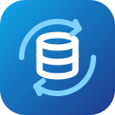
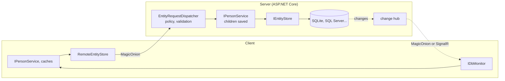

<p align="center">
  
</p>

<p align="center">
  <a href="https://github.com/cedric56/Queryeables/actions/workflows/ci.yml"></a>
  <a href="LICENSE.txt"></a>
  
  
  <a href="https://cedric56.github.io/Queryeables/"></a>
</p>

# Queryeables

**One data-access API for .NET, local or remote: your entities, their caches and their children, the same code everywhere.**

A view model or a service asks for `IPersonService` or `IEntityCache<Person, long>`. It never knows whether the data comes
from SQLite through Dommel, from SQL Server through EF Core, or from a server across the network.

**What it is not:** not an ORM (it runs on top of Dommel or EF Core, which you keep for complex queries), not a query
builder or a query-string filter library, and not a GraphQL server. It is the layer above them: the same store API locally
and remotely, in-memory caches that follow the database, parent-child graphs saved in one transaction, and change
notifications between clients.

> **Status:** early. Packages are not published on NuGet yet, and the API may still change.

📖 **[Documentation](https://cedric56.github.io/Queryeables/)**: [getting started](docs/getting-started.md),
[guides](docs/guides/stores-and-transactions.md), [benchmarks](docs/benchmarks.md),
[when to choose something else](docs/introduction.md#when-to-choose-something-else).

## In one minute

```csharp
[EntityCache]                                            // an in-memory cache that follows the database
public class Person
{
    public long Id { get; set; }
    public string Name { get; set; } = "";

    [EntityGraph(ParentNavigation = nameof(Contact.Owner))]   // saved, removed and loaded with the person
    public List<Contact>? Contacts { get; set; }          // null = not loaded: saving leaves the contacts alone
}

public class Contact
{
    public long Id { get; set; }
    public long PersonId { get; set; }                   // the foreign key, found by its name
    public Person? Owner { get; set; }
}

services.UseQueryeables(q => q
    .UseSqlite("Data Source=app.db")                     // the provider
    .AddGeneratedEntities());                            // what the attributes describe, written by the source generator
```

```csharp
public sealed class PersonsViewModel(IPersonService persons, IEntityCache<Person, long> cache)
{
    public IReadOnlyCollection<Person> All => cache.Entities;                       // kept up to date by the database
    public Task<DbResult> SaveAsync(Person person) => persons.SaveAsync(person);    // the person and its contacts, one transaction
}
```

Two attributes and one registration call. To use a remote server instead, the client changes one line:
`UseMagicOnion("https://server:5001")` instead of `UseSqlite(...)`. The [sample](Samples/Queryeables.Sample/Program.cs)
runs this end to end on SQLite, then the same service as a remote client of an in-process server.

## Start with your provider

Each provider brings the [`Queryeables`](Queryeables.Core/README.md) package: the contracts, the remote-access core, the
setup and the source generator. There is nothing else to add.

| Data | Package | Setup |
| --- | --- | --- |
| SQLite | [`Queryeables.Sqlite`](Queryeables.Sqlite/README.md) | `q.UseSqlite("Data Source=app.db")`, with change notifications |
| PostgreSQL | [`Queryeables.PostgreSql`](Queryeables.PostgreSql/README.md) | `q.UseNpgsql(connectionString, notifications: n => n.Watch<Person>(p => p.Id))`, with change notifications |
| SQL Server, MySQL... | [`Queryeables.Dommel`](Queryeables.Dommel/README.md) | `q.UseDommel<SqlConnection>(connectionString)` |
| Any EF Core provider | [`Queryeables.EntityFramework`](Queryeables.EntityFramework/README.md) | `q.UseEntityFramework(sp => new AppDbContext(options))` |
| A Queryeables server | [`Queryeables.Onion.Client`](Queryeables.Onion.Client/README.md) | `q.UseMagicOnion("https://server:5001")` |
| Your own store | [`Queryeables`](Queryeables.Core/README.md) | `q.UseStores(sp => new MyStore(...))` |

```bash
dotnet add package Queryeables.Sqlite   # or .PostgreSql, .Dommel, .EntityFramework, .Onion.Client
```

## What you get

- **One store API**, `IEntityStore`: async CRUD, filters, paging, counting and transactions, identical for Dommel, EF Core
  and a remote server. Every implementation passes the same [contract tests](Queryeables.Tests/Contract).
- **Entity graphs**, `[EntityGraph]`: a parent saved, removed and loaded with its children, navigation properties set,
  related entities found in their caches. The generator writes `I{Parent}Service` and `{Parent}Graph`, and a mistake in
  the attributes is a compile error (QRY001 to QRY009).
- **Caches that follow the database**, `[EntityCache]`: row by row, bursts coalesced, incremental resynchronization after
  a reconnection.
- **Transactions that report their outcome**: a `DbResult` with an error kind (`Validation`, `Conflict`, `NotFound`,
  `Forbidden`...) instead of an exception.
- **Remote access without coupling**: the remote core speaks to an `IEntityRemote`, and MagicOnion is one transport among
  others. No SQL from the client, a whitelist of filter operators, an access policy per type.
- **Change notifications** from SQLite or SQL Server, relayed to clients over MagicOnion or SignalR, without echoing a
  client's own changes.
- **Sync conventions**: `[LastModified]`, `[SoftDelete]`, optimistic concurrency with `[ConcurrencyCheck]`.
- **Native AOT and trimming analyzers** on every library; the generator replaces reflection-based registration.

## Local or remote, the same code



**Server**: [`Queryeables.Server`](Queryeables.Server/README.md).

```csharp
builder.Services.UseQueryeables(q => q
    .UseSqlite("Data Source=server.db")
    .AddGeneratedEntities()
    .AddMagicOnionServer(server => server
        .Expose<Person>(EntityAccessPolicies.Authenticated)
        .Expose<Contact>(EntityAccessPolicies.Authenticated)));
```

**Client**: `q.UseMagicOnion("https://server:5001").AddGeneratedEntities()`. Keep the entities in a shared library:
`AddGeneratedEntities()` registers them on both sides.

## Queries

```csharp
var page = await stores.Query<Person>()
    .Where(p => p.Name.StartsWith(search) || p.Id == id)
    .OrderBy(p => p.Name).ThenByDescending(p => p.Id)
    .Skip(50).Take(25)
    .Select(p => new PersonRow(p.Id, p.Name))
    .ToListAsync();
```

The same query locally and remotely: filtered, sorted and paged by the database with EF Core, by the server with a remote
store. See [stores and transactions](docs/guides/stores-and-transactions.md#composed-queries).

## Transactions and DbResult

```csharp
await using var store = stores.Create();      // IEntityStoreFactory, registered by the provider
DbResult result = await store.RunInTransactionAsync(async s =>
{
    await s.SaveAsync(order, o => o.Id);       // insert when the key is 0, update otherwise
    await s.UpdateAsync(customer);
});

if (!result.Successful)
    Show(result.ErrorCode, result.Exception, result.Errors);
```

Exceptions inside the work and failed commits become a failed `DbResult`; cancellation still throws. `.OrThrow()` turns a
failure back into an `EntityStoreException`. Register an `IEntityStoreFactory`, never a store: a store is one connection,
disposed by its user.

## Is it for you?

Choose Queryeables for an application whose data is local today and may be shared through a server tomorrow, whose clients
must see each other's changes, or that saves parent-child aggregates as one unit. Choose something else for an
offline-first mobile app (Datasync Community Toolkit), strong real-time consistency (ActualLab.Fusion), a complete
application framework (ABP), or complex queries (EF Core or Dapper directly, next to Queryeables). The
[introduction](docs/introduction.md) compares them.

## Packages

| Package | Contents |
| --- | --- |
| [`Queryeables`](Queryeables.Core/README.md) | [Contracts](Queryeables.Abstraction/README.md), [remote core](Queryeables.Remote/README.md), `UseQueryeables`, [source generator](Queryeables.Generated/README.md). No database, no transport |
| [`Queryeables.Dommel`](Queryeables.Dommel/README.md) | Stores on Dommel: generated keys, optimistic concurrency, SQL logging |
| [`Queryeables.Sqlite`](Queryeables.Sqlite/README.md) | Dommel on SQLite, with change notifications |
| [`Queryeables.PostgreSql`](Queryeables.PostgreSql/README.md) | Dommel on PostgreSQL, with change notifications |
| [`Queryeables.EntityFramework`](Queryeables.EntityFramework/README.md) | Stores on EF Core |
| [`Queryeables.SqlDependency`](Queryeables.SqlDependency/README.md) | SQL Server change notifications |
| [`Queryeables.Onion`](Queryeables.Onion/README.md) | MagicOnion messages and serializer, shared by client and server |
| [`Queryeables.Onion.Client`](Queryeables.Onion.Client/README.md) | `UseMagicOnion`, change hub subscription |
| [`Queryeables.Server`](Queryeables.Server/README.md) | `AddMagicOnionServer`, the MagicOnion service and change hub |
| [`Queryeables.SignalR`](Queryeables.SignalR/README.md), [`.SignalR.Server`](Queryeables.SignalR.Server/README.md) | Change notifications over SignalR |

## Security

- **Never expose `EntityAccessPolicies.AllowAll` on a public network.** Configure ASP.NET Core authentication and use
  `Authenticated`, `ReadOnly`, or `EntityAccessPolicies.From(request => ...)`.
- Keep connection strings and certificate passwords out of the source code.
- No SQL and no expression goes over the wire: only "property, operator, value" conditions on exposed types.

## Native AOT

Every library sets `IsAotCompatible` and builds without trimming or AOT warnings; the EF Core store is marked as
requiring unreferenced and dynamic code, like EF Core itself. At run time, EF Core and Dapper/Dommel
generate code (fine with trimming, not with full Native AOT), MagicOnion clients need the MagicOnion source generator, and
entities sent over MagicOnion need `[MessagePackObject]`.

## Build and test

```bash
dotnet test Queryeables.slnx
dotnet run --project Samples/Queryeables.Sample
dotnet run -c Release --project Queryeables.Benchmarks -- --filter "*"
dotnet pack Queryeables.slnx -c Release -o ./artifacts -p:Version=0.1.0
```

See [CONTRIBUTING.md](CONTRIBUTING.md) for the rules of the code and the release steps, and [CHANGELOG.md](CHANGELOG.md).

Design ideas come from the Datasync Community Toolkit, ActualLab.Fusion, ABP and Breeze: see [CREDITS.md](CREDITS.md).
Released under the [MIT License](LICENSE.txt).
