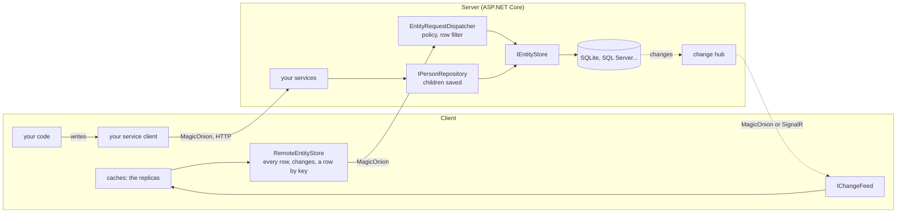

<p align="center">
  
</p>

<p align="center">
  <a href="https://github.com/cedric56/Queryeables/actions/workflows/ci.yml"></a>
  <a href="LICENSE.txt"></a>
  
  
  <a href="https://cedric56.github.io/Queryeables/"></a>
</p>

# Queryeables

**A thin data layer for .NET: one store API on your database, caches that follow it, parent-child graphs saved in one
transaction, and read-only replicas of a server on its clients.**

A view model or a service asks for `IPersonRepository` or `IPersonCache`. It does not know whether the rows come from
SQLite, SQL Server, PostgreSQL or MongoDB, or from a server whose clients keep a replica of what they may read.

**What it is not:** not an ORM (it runs on Dommel, EF Core or the MongoDB driver, which you keep for complex queries), not
a query builder, not a GraphQL server, and not an offline synchronization engine (that is the
[Datasync Community Toolkit](https://github.com/CommunityToolkit/Datasync), which Queryeables works on).

> **Status:** early. Packages are not published on NuGet yet, and the API may still change. To try it now, build them
> from the sources into a local package source: three commands, in
> [contributing](CONTRIBUTING.md#trying-the-packages-before-they-are-published).

```bash
dotnet new install Queryeables.Templates
dotnet new queryeables-console -n MyApp            # SQLite, a cache, a person and its contacts
dotnet new queryeables-client-server -n Shop       # a MagicOnion server, a client with replicas and a service to write
```

📖 **[Documentation](https://cedric56.github.io/Queryeables/)**: [getting started](docs/getting-started.md),
[tutorial](docs/tutorial.md) (local app, cache, graph, server), [guides](docs/guides/stores-and-transactions.md),
[benchmarks](docs/benchmarks.md), [when to choose something else](docs/introduction.md#when-to-choose-something-else).

## In one minute

```csharp
[EntityCache]                                            // an in-memory cache that follows the database
public class Person
{
    public long Id { get; set; }
    public string Name { get; set; } = "";

    [EntityGraph(ParentNavigation = nameof(Contact.Owner))]   // saved, removed and loaded with the person
    public List<Contact>? Contacts { get; set; }          // null = not loaded: saving leaves the contacts alone
}

public class Contact
{
    public long Id { get; set; }
    public long PersonId { get; set; }                   // the foreign key, found by its name
    public Person? Owner { get; set; }
}

services.UseQueryeables(q => q
    .UseSqlite("Data Source=app.db")                     // the provider
    .AddGeneratedEntities()                              // what the attributes describe, written by the source generator
    .CreateTables());                                    // the tables Person and Contact, when missing
```

```csharp
public sealed class PersonsViewModel(IPersonRepository persons, IPersonCache cache)
{
    public IReadOnlyCollection<Person> All => cache.Entities;                       // up to date: saves, and the database
    public Task<EntityResult> SaveAsync(Person person) => persons.SaveAsync(person);    // the person and its contacts, one transaction
    public Task<Person?> OpenAsync(long id) => persons.GetAsync(id);                // with its contacts
}
```

Two attributes and one registration call, no `using` (the package adds its namespaces). The
[sample](Samples/Queryeables.Sample/Program.cs) runs this on SQLite, then reads the same caches as a replica of an
in-process server.

## Start with your provider

Each provider brings the [`Queryeables`](Queryeables.Core/README.md) package: the contracts, the caches and graphs, the
replica core, the setup and the source generator. There is nothing else to add.

| Data | Package | Setup |
| --- | --- | --- |
| SQLite | [`Queryeables.Sqlite`](Queryeables.Sqlite/README.md) | `q.UseSqlite("Data Source=app.db")`, with change notifications |
| PostgreSQL | [`Queryeables.PostgreSql`](Queryeables.PostgreSql/README.md) | `q.UseNpgsql(connectionString, notifications: n => n.Watch<Person>(p => p.Id))`, with change notifications |
| MongoDB | [`Queryeables.MongoDB`](Queryeables.MongoDB/README.md) | `q.UseMongoDB(connectionString, "app", notifications: n => n.Watch<Person>())`, with change streams |
| SQL Server, MySQL... | [`Queryeables.Dommel`](Queryeables.Dommel/README.md) | `q.UseDommel<SqlConnection>(connectionString)` |
| Any EF Core provider | [`Queryeables.EntityFramework`](Queryeables.EntityFramework/README.md) | `q.UseEntityFramework(sp => new AppDbContext(options))` |
| A Datasync client database (offline) | [`Queryeables.Datasync`](Queryeables.Datasync/README.md) | `q.UseDatasync(sp => new AppDbContext(options))` |
| A replica of a Queryeables server | [`Queryeables.MagicOnion.Client`](Queryeables.MagicOnion.Client/README.md) | `q.UseMagicOnion("https://server:5001")` |
| Your own store | [`Queryeables`](Queryeables.Core/README.md) | `q.UseStores(sp => new MyStore(...))` |

```bash
dotnet add package Queryeables.Sqlite   # or .PostgreSql, .MongoDB, .Dommel, .EntityFramework, .Datasync, .MagicOnion.Client
```

## What you get

- **One store API**, `IEntityStore`: async CRUD, LINQ filters, sorts, pages, projections, counting and transactions,
  identical on Dommel, EF Core and MongoDB. Every implementation passes the same [contract tests](Queryeables.Tests/Contract).
- **Entity graphs**, `[EntityGraph]`: a parent saved, removed and loaded with its children, navigation properties set,
  related entities found in their caches. The generator writes `I{Parent}Repository` and `{Parent}Graph`, and a mistake in
  the attributes is a compile error (QRY001 to QRY009).
- **Caches that follow the database**, `[EntityCache]`: row by row, bursts coalesced, incremental resynchronization after
  a reconnection (`[LastModified]`).
- **Results instead of exceptions**: a transaction returns an `EntityResult` with an error kind (`Validation`, `Conflict`,
  `NotFound`, `Forbidden`...); `.OrThrow()` when you prefer the exception.
- **Read-only replicas on the clients**: a server publishes its types; each client's caches hold the rows its user may
  read, kept up to date by the server's notifications and queried in memory. A client sends no query and no generic write:
  it writes through your services. See [remote access](docs/guides/remote-access.md).
- **Offline through Datasync**: a client that works without the server keeps a local database synchronized by Datasync;
  Queryeables reads and writes it, and its caches follow each pull. See [offline with Datasync](docs/guides/offline-with-datasync.md).
- **Per-user data**: a policy per type and a row filter per user on the server; `ChangeUserAsync()` on the client empties
  the caches of the previous user before anything is loaded for the next.
- **Change notifications** from SQLite, PostgreSQL, SQL Server or MongoDB, relayed to the clients over MagicOnion or SignalR.
- **Sync conventions**: `[LastModified]`, `[SoftDelete]`, optimistic concurrency with `[ConcurrencyCheck]`.
- **Traces and metrics** through `ActivitySource` and `Meter` (`Queryeables`): remote calls, server requests, caches,
  changes. See [observability](docs/guides/observability.md).
- **Trimming and AOT analyzers** clean on every library; the generator replaces reflection-based registration. Full
  Native AOT works for a replica client, not over Dommel or EF Core: see [Native AOT](#native-aot).

## A server, replicas on its clients



**Server**: [`Queryeables.MagicOnion.Server`](Queryeables.MagicOnion.Server/README.md).

```csharp
builder.Services.UseQueryeables(q => q
    .UseSqlite("Data Source=server.db")
    .AddGeneratedEntities()
    .AddMagicOnionServer(server => server
        .Expose<Order>(EntityAccessPolicies.Authenticated,
            rows: RowLevelSecurity.For<Order, long>(o => o.Id, user => o => o.OwnerId == OwnerOf(user)))
        .ExposeGenerated(EntityAccessPolicies.Authenticated)));
// ...
app.MapQueryeables();
app.MapMagicOnionService<OrderService>();       // how the clients write: your rules, your transactions
```

**Client**: `q.UseMagicOnion("https://server:5001").AddGeneratedEntities()`. Its caches (`IOrderCache`) are replicas: every
row its user may read, at most `maxReadSize` (10,000) per type, then each notified change read again by key. A row that
leaves the user's filter leaves the replica. Writes go through `app.Create<IOrderService>(url)`; the replicas, the
author's included, follow by the notification of the change. Keep the entities in a shared library: they travel as JSON,
without attributes.

## Queries

```csharp
var page = await stores.Query<Person>()
    .Where(p => p.Name.StartsWith(search) || p.Id == id)
    .OrderBy(p => p.Name).ThenByDescending(p => p.Id)
    .Skip(50).Take(25)
    .Select(p => new PersonRow(p.Id, p.Name))
    .ToListAsync();
```

Filtered, sorted and paged by the database, on a local or server store. A replica is queried in memory, with LINQ on
`cache.Entities`. See [stores and transactions](docs/guides/stores-and-transactions.md#reading).

## Transactions and EntityResult

```csharp
await using var store = stores.Create();      // IEntityStoreFactory, registered by the provider
EntityResult result = await store.RunInTransactionAsync(async s =>
{
    await s.SaveAsync(order);                  // insert when the key is 0, update otherwise
    await s.UpdateAsync(customer);
});

if (!result.Successful)
    Show(result.ErrorCode, result.Exception, result.Errors);
```

Exceptions inside the work and failed commits become a failed `EntityResult`; cancellation still throws. Register an
`IEntityStoreFactory`, never a store: a store is one connection, disposed by its user.

## Is it for you?

Choose Queryeables for an application that wants caches that follow its database, parent-child aggregates saved as one
unit, or clients that read a live replica of a server's data and write through its services. Choose something else for
offline-first synchronization (the Datasync Community Toolkit, with Queryeables on top if you want its caches and graphs),
strong real-time consistency (ActualLab.Fusion), a complete application framework (ABP), or complex queries (EF Core or
Dapper directly, next to Queryeables). The [introduction](docs/introduction.md) compares them.

## Packages

| Package | Contents |
| --- | --- |
| [`Queryeables`](Queryeables.Core/README.md) | [Contracts](Queryeables.Abstraction/README.md), [replica core](Queryeables.Remote/README.md), `UseQueryeables`, [source generator](Queryeables.Generated/README.md). No database, no transport |
| [`Queryeables.Dommel`](Queryeables.Dommel/README.md) | Stores on Dommel: generated keys, optimistic concurrency, SQL logging |
| [`Queryeables.Sqlite`](Queryeables.Sqlite/README.md) | Dommel on SQLite, with change notifications |
| [`Queryeables.PostgreSql`](Queryeables.PostgreSql/README.md) | Dommel on PostgreSQL, with change notifications |
| [`Queryeables.MongoDB`](Queryeables.MongoDB/README.md) | Stores on MongoDB, with transactions and change streams |
| [`Queryeables.EntityFramework`](Queryeables.EntityFramework/README.md) | Stores on EF Core |
| [`Queryeables.SqlDependency`](Queryeables.SqlDependency/README.md) | SQL Server change notifications |
| [`Queryeables.Datasync`](Queryeables.Datasync/README.md) | Queryeables on the local database of a Datasync client |
| [`Queryeables.MagicOnion`](Queryeables.MagicOnion/README.md) | MagicOnion messages and serializers, shared by client and server |
| [`Queryeables.MagicOnion.Client`](Queryeables.MagicOnion.Client/README.md) | `UseMagicOnion`: replicas, change hub subscription, clients of your services |
| [`Queryeables.MagicOnion.Server`](Queryeables.MagicOnion.Server/README.md) | `AddMagicOnionServer`, `MapQueryeables`, the change hub |
| [`Queryeables.SignalR`](Queryeables.SignalR/README.md), [`.SignalR.Server`](Queryeables.SignalR.Server/README.md) | Change notifications over SignalR |
| [`Queryeables.Templates`](Queryeables.Templates/README.md) | `dotnet new queryeables-console`, `queryeables-client-server` |

## Security

- **Never expose `EntityAccessPolicies.AllowAll` on a public network.** Configure ASP.NET Core authentication and use
  `Authenticated` or `EntityAccessPolicies.From(request => ...)`.
- A client reaches only the exposed types, and of each only three reads: every row it may read, the changes, a row by key.
  No SQL, no expression and no filter of the client goes over the wire.
- Keep each user to its own rows with a row filter (`rows: RowLevelSecurity.For<Order, long>(...)`): it is applied to every
  read, by key included. A replica beyond `maxReadSize` is refused rather than cut.
- Keep connection strings and certificate passwords out of the source code. See [security](docs/guides/security.md).

## Native AOT

Every library sets `IsAotCompatible` and builds without trimming or AOT warnings. That is a guarantee about Queryeables'
own code, not about every provider at run time:

| Setup | Trimming | Full Native AOT |
| --- | --- | --- |
| Replica client, caches, graphs | Yes | Yes: proven in CI by `Queryeables.AotSmoke` (in-process transport) |
| MagicOnion transport (`UseMagicOnion`) | Yes, with a `JsonEntitySerializer` on a `JsonSerializerContext` | Same, with the MagicOnion source generator; not run in CI. The default JSON serializer reads the types by reflection |
| Dommel / Dapper (`UseSqlite`, `UseNpgsql`, `UseDommel`) | Yes | No: Dapper emits IL at run time |
| EF Core (`UseEntityFramework`, `UseDatasync`) | Yes | No: marked as requiring dynamic code, like EF Core itself |
| MongoDB (`UseMongoDB`) | No | No: the driver maps by reflection; marked like EF Core |

See [Native AOT](docs/guides/aot.md).

## Build and test

```bash
dotnet test Queryeables.slnx
dotnet run --project Samples/Queryeables.Sample
dotnet run -c Release --project Queryeables.Benchmarks -- --filter "*"
dotnet pack Queryeables.slnx -c Release -o ./artifacts -p:Version=0.1.0
```

See [CONTRIBUTING.md](CONTRIBUTING.md) for the rules of the code and the release steps, and [CHANGELOG.md](CHANGELOG.md).

Design ideas come from the Datasync Community Toolkit, ActualLab.Fusion and ABP: see [CREDITS.md](CREDITS.md).
Released under the [MIT License](LICENSE.txt).
